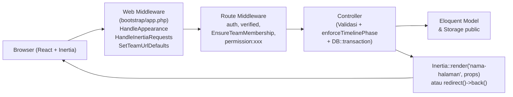

# Developer Guide & Panduan Troubleshooting — Sistem Manajemen Tugas Akhir (`manajemen-ta`)

Dokumen ini disusun khusus untuk **programmer / maintainer selanjutnya** agar dapat memahami arsitektur, menemukan lokasi kode setiap fitur dalam hitungan detik, menambah modul baru dengan aman, serta menyelesaikan masalah (*debugging*) tanpa menebak-nebak.

---

## Daftar Isi

1. [Gambaran Arsitektur & Alur Request](#1-gambaran-arsitektur--alur-request)
2. [Setup Lingkungan, Perintah Penting & Akun Demo](#2-setup-lingkungan-perintah-penting--akun-demo)
3. [Peta Cepat Modul (Bug di Fitur X → Cek File Y)](#3-peta-cepat-modul-bug-di-fitur-x--cek-file-y)
4. [Penjelasan 5 Mekanisme Kritis](#4-penjelasan-5-mekanisme-kritis)
5. [Cookbook: Cara Menambah Modul/Halaman Baru](#5-cookbook-cara-menambah-modulhalaman-baru)
6. [Panduan Troubleshooting (Gejala → Penyebab → Solusi)](#6-panduan-troubleshooting-gejala--penyebab--solusi)
7. [Catatan Tech Debt & File Legacy](#7-catatan-tech-debt--file-legacy)

---

## 1. Gambaran Arsitektur & Alur Request

Aplikasi ini menggunakan pola **Modern Monolith (Server-Driven SPA)**:
- **Backend**: Laravel 13 (`PHP ^8.3`), Laravel Fortify (Auth, 2FA, Passkeys), Eloquent ORM.
- **Bridge**: Inertia.js v3 + Laravel Wayfinder (type-safe routes di TypeScript).
- **Frontend**: React 19, TypeScript 5.7, Tailwind CSS v4, Radix UI / Base UI, Sonner Toast, Vite 8.

### Siklus Hidup Satu Request HTTP


### Shared Props Global (`HandleInertiaRequests.php`)
Setiap halaman React otomatis menerima *props* global berikut via `usePage().props` (lihat `app/Http/Middleware/HandleInertiaRequests.php`):
- `auth.user` — object user yang sedang login.
- `auth.roles` — array nama role dalam **huruf kecil** (misal `['admin']`).
- `auth.permissions` — gabungan seluruh permission dari semua role user (`User::getAllPermissionsAttribute()`).
- `auth.isAdmin` — boolean apakah user dianggap admin/pengelola.
- `currentTeam` & `teams` — data team aktif (`currentTeam.slug` dipakai membentuk URL `/{current_team}/...`).
- `timeline.activeYear`, `timeline.activePhases`, `timeline.isAdminOverride` — fase timeline yang sedang terbuka hari ini.

---

## 2. Setup Lingkungan, Perintah Penting & Akun Demo

### Instalasi dari Awal
```bash
composer install
npm install
copy .env.example .env
php artisan key:generate
php artisan storage:link          # WAJIB agar dokumen TA yang diunggah bisa diakses browser
php artisan migrate:fresh --seed  # Buat tabel + isi data master + data skenario demo lengkap
```

### Menjalankan Server Pengembangan
```bash
composer run dev
```
Perintah ini menjalankan secara bersamaan:
1. `php artisan serve` (HTTP server Laravel)
2. `php artisan queue:listen --tries=1 --timeout=0` (worker antrean)
3. `npm run dev` (Vite HMR + Wayfinder route sync)

### Perintah Quality Assurance (Jalankan Sebelum Commit/Push)
```bash
composer run lint        # Format PHP otomatis (Laravel Pint)
composer run types:check # Analisis tipe statis PHP (PHPStan/Larastan)
npm run types:check      # Cek tipe TypeScript (tsc --noEmit)
php artisan test         # Jalankan test suite Pest PHP
composer run ci:check    # Jalankan seluruh cek frontend + backend sekaligus
```

### Berpindah Basis Data (SQLite Dev ↔ MySQL / SQL Server Prod)
Aplikasi memakai Eloquent ORM & migrasi standar. Ubah variabel `DB_CONNECTION`, `DB_HOST`, `DB_PORT`, `DB_DATABASE`, `DB_USERNAME`, `DB_PASSWORD` di `.env`, lalu jalankan `php artisan migrate --seed`.

### Akun Demo Bawaan Seeder (`database/seeders/DatabaseSeeder.php`)
Password seluruh akun seeder: **`password`**

| Email | Role di Seeder | Skenario Demo (`ScheduleDemoSeeder.php`) |
| :--- | :--- | :--- |
| `admin@polman-bandung.ac.id` | Admin | Akses penuh + RBAC + Bypass Timeline |
| `panitia@polman-bandung.ac.id` | Panitia | Jalankan Matchmaking & Auto-Scheduler |
| `siti@polman-bandung.ac.id` | Kaprodi | ACC Judul Mandiri milik Zahra |
| `harry@polman-bandung.ac.id` | Dosen Pembimbing | Pembimbing 1 Arbiyan, slot tersedia Besok & Lusa |
| `danu@polman-bandung.ac.id` | Dosen Pembimbing | Pembimbing 2 Arbiyan, slot tersedia Besok & Lusa |
| `budi@polman-bandung.ac.id` | Dosen Pembimbing | Kandidat Penguji (bukan pembimbing Arbiyan) |
| `arbiyan@polman-bandung.ac.id` | Mahasiswa | **Siap Sidang**: 8x bimb P1 & P2, 5x seminar, iThenticate 14%, Sempro & Semhas approved |
| `aqila@polman-bandung.ac.id` | Mahasiswa | **Siap Matchmaking**: 3 pilihan topik Tipe 2 sudah dikunci (`Locked`) |
| `zahra@polman-bandung.ac.id` | Mahasiswa | **Pengajuan Mandiri**: Judul mandiri berstatus `Pending Kaprodi` |

> **Catatan**: Jika database Anda memakai seed/akun kustom (misal 4 role: `Admin`, `Dosen`, `Dosen Pembimbing`, `Mahasiswa`), Anda dapat mengecek isi aktual tabel `roles` dan `users` kapan saja melalui `php artisan tinker`.

---

## 3. Peta Cepat Modul (Bug di Fitur X → Cek File Y)

Gunakan tabel ini sebagai **peta navigasi cepat** saat ada laporan bug atau permintaan perubahan:

| Fitur / Masalah | Controller Backend | Model & Tabel Utama | Halaman Frontend (`.tsx`) | Route Utama (`routes/web.php` / `settings.php`) |
| :--- | :--- | :--- | :--- | :--- |
| **Dashboard (3 Mode)** | `DashboardController.php` | `TaProject`, `Bimbingan`, `SeminarAttendance`, `MilestoneSchedule`, `TaDocument` | `pages/dashboard.tsx` | `GET /{team}/dashboard` |
| **RBAC & Hak Akses** | `RbacController.php`, `Middleware/CheckPermission.php` | `Role` (`roles`), `User` (`role_user`) | `pages/rbac.tsx`, `components/app-sidebar.tsx` | `GET /{team}/rbac`, `POST /rbac/*` |
| **Data Master** | `MasterDataController.php` | `Prodi`, `Competency`, `JabatanFungsional` | `pages/master-data.tsx` | `GET /{team}/master-data`, `POST/DELETE /master-data/*` |
| **Tahun Ajaran & Timeline** | `AcademicYearController.php`, `TimelineController.php`, `Controller.php` (`enforceTimelinePhase`) | `AcademicYear`, `Timeline`, `TimelineItem` | `pages/timeline.tsx` | `GET /{team}/timeline-kontrol`, `POST /academic-years/*`, `/timelines/*` |
| **Profil Akademik & Skill** | `AcademicProfileController.php` | `DosenProfile`, `MahasiswaProfile` | `pages/academic-profile.tsx` | `GET /settings/profil-akademik`, `POST /settings/profil-akademik/dosen\|mahasiswa` |
| **Bursa Judul & Pengajuan** | `TaProjectController.php` | `TaProject`, `ProjectPembimbing`, `project_mahasiswas` | `pages/tema-matchmaking.tsx` | `GET /{team}/tema-matchmaking`, `POST /ta-projects`, `POST /ta-projects/{project}/approve` |
| **Algoritma Matchmaking** | `MatchmakingController.php` | `TemaSelection`, `TaProject`, `MahasiswaProfile` | `pages/tema-matchmaking.tsx` | `POST /tema-matchmaking/lock`, `/run-algorithm`, `/{project}/override`, `/finalize`, `DELETE /members/{id}` |
| **Logbook Bimbingan** | `BimbinganController.php` | `Bimbingan` (`bimbingans`) | `pages/bimbingan.tsx` | `GET/POST /{team}/bimbingan`, `PUT/DELETE /{id}`, `PATCH /{id}/verify` |
| **Dokumen TA & iThenticate** | `DocumentController.php` | `TaDocument` (`ta_documents`) | `pages/dokumen.tsx` | `GET/POST /{team}/dokumen`, `POST /{id}/replace`, `DELETE /{id}`, `PATCH /{id}/verify` |
| **Kehadiran Seminar** | `SeminarAttendanceController.php` | `SeminarAttendance`, `MilestoneSchedule` | `pages/kehadiran-seminar.tsx` | `GET /{team}/kehadiran-seminar`, `POST /record-attendees`, `PUT/DELETE /{id}`, `PATCH /{id}/verify` |
| **Pendaftaran Milestone** | `RegistrationController.php` | `MilestoneRegistration` (+ cek `Bimbingan`, `SeminarAttendance`, `TaDocument`) | `pages/pendaftaran.tsx` | `GET/POST /{team}/pendaftaran`, `PATCH /{id}/verify` |
| **Penjadwalan & Auto-Scheduler** | `ScheduleController.php` | `MilestoneSchedule`, `ScheduleAssignee`, `DosenAvailability`, `dosen_blocks` | `pages/jadwal.tsx` | `GET /{team}/jadwal`, `POST/DELETE /availabilities`, `POST /generate`, `POST /{id}/assignee`, `PUT /{id}`, `POST /publish(-all)` |
| **Auth, 2FA, Passkeys & Teams** | `Settings/*`, `Teams/*`, Laravel Fortify | `User`, `Team`, `Membership`, `TeamInvitation`, `passkeys` | `pages/auth/*`, `pages/settings/*`, `pages/teams/*` | `routes/settings.php` & Fortify routes |

---

## 4. Penjelasan 5 Mekanisme Kritis

### 4.1 Multi-Team URL (`{current_team}`) — WAJIB DIPAHAMI!
Seluruh route operasional berada di dalam grup:
```php
Route::prefix('{current_team}')
    ->middleware(['auth', 'verified', EnsureTeamMembership::class])
    ->group(function () { ... });
```
**Implikasi Kritis untuk Programmer**:
1. **Urutan Parameter Controller**: Setiap method controller yang memiliki *route parameter* (seperti `{bimbingan}`, `{document}`, `{schedule}`, `{project}`) **WAJIB** menerima parameter `$currentTeam` di urutan pertama setelah `Request`:
   ```php
   // BENAR
   public function verify(Request $request, string $currentTeam, Bimbingan $bimbingan)

   // SALAH -> $bimbingan akan mencoba mengambil slug team dan menghasilkan 404!
   public function verify(Request $request, Bimbingan $bimbingan)
   ```
2. **Syarat Akun Bisa Masuk Dashboard**: Setiap user **harus** memiliki `current_team_id` dan terdaftar di `team_members`. Saat membuat user lewat seeder atau skrip manual, selalu panggil `App\Actions\Teams\CreateTeam` seperti di `DatabaseSeeder.php` baris 200–203.
3. **Default URL Parameter**: `SetTeamUrlDefaults` otomatis menyuntikkan slug team ke helper `route(...)` Laravel.

### 4.2 Dynamic RBAC & Penentuan Mode Tampilan (Role Detection)
Sistem memiliki **dua lapisan pengecekan akses** yang perlu dipahami:
1. **Lapisan Route & Sidebar (Permission-Based)**:
   - Middleware `permission:xxx` (`app/Http/Middleware/CheckPermission.php`) memeriksa `$user->hasPermission('xxx')`. Role bernama `Admin` **otomatis lolos semua permission**.
   - `RbacController::discoverModulesAndPermissions()` memindai seluruh route di `routes/web.php` secara otomatis untuk membentuk daftar permission di halaman `/rbac`.
   - `resources/js/components/app-sidebar.tsx` menyaring menu navigasi berdasarkan `page.props.auth.permissions` menggunakan `canAny(permissions)` dan `canAnyModule(modules)`.
2. **Lapisan Mode Tampilan Controller (Profile & Role-Based)**:
   - Beberapa halaman (seperti `DashboardController`, `BimbinganController`, `DocumentController`, `SeminarAttendanceController`, `RegistrationController`, `ScheduleController`) menampilkan UI berbeda untuk **Admin/Pengelola**, **Dosen/Pembimbing**, dan **Mahasiswa**.
   - Pengecekan dosen biasanya menggunakan `$user->dosenProfile()->exists()` **atau** pengecekan nama role (`Dosen Pembimbing`, `Penguji`, dll.).
   - **Penting**: Jika Anda membuat akun dosen baru secara manual di database, pastikan profilnya (`dosen_profiles`) juga terisi agar tampilan verifikasi dosen aktif di seluruh modul!

### 4.3 Timeline Gatekeeper (`Controller::enforceTimelinePhase`)
Terletak di `app/Http/Controllers/Controller.php` baris 33–59:
- Dipanggil pada `TaProjectController::store()` dan `MatchmakingController::lockChoices()` dengan keyword `'pembagian_tema'`.
- Memeriksa apakah tanggal hari ini (`Carbon::today()`) berada di antara `start_date` dan `end_date` pada `timeline_items` milik `AcademicYear` yang `is_active = true`.
- Jika user berstatus Admin (`getUserRoleFlags($user)->isAdmin`), pengecekan **di-bypass otomatis**.

### 4.4 Tiga Algoritma Inti
1. **Vector Matchmaking (`MatchmakingController.php`)**:
   - `runAlgorithm()` berjalan di dalam `DB::transaction()`.
   - Hanya me-reset proyek `Tipe 2` yang masih `Matchmaking` atau `Draft Plotting` (proyek `Assigned` tidak tersentuh).
   - Menarik `TemaSelection` berstatus `Locked`/`Matched` di luar mahasiswa yang sudah `Assigned`, diurutkan *ascending* berdasarkan `locked_at` (FCFS).
   - `calculateMatchScore($studentSkills, $requiredSkills)` hanya mengevaluasi skill dengan syarat `level > 1`. Mahasiswa dinyatakan `eligible = true` jika semua level skill aktualnya `>=` target.
   - Jika cocok & `mahasiswas()->count() < kuota`, mahasiswa di-`attach`, proyek pindah ke `Draft Plotting`, dan seleksi menjadi `Matched`.
   - Aksi `finalizePlotting()` meresmikan seluruh `Draft Plotting` menjadi `Assigned`.

2. **Validasi Prasyarat Pendaftaran (`RegistrationController::store`)**:
   - **Sempro / Semhas**: `bimbingans` (`pembimbing_ke = 1`, `status = 'approved'`) minimal **6 sesi**, + `dokumen_kti_link` & `dokumen_produk_link`.
   - **Sidang**: `bimbingans` (`pembimbing_ke = 1`, `status = 'approved'`) minimal **8 sesi**, `seminar_attendances` (`status = 'approved'`) minimal **5 kali**, `ta_documents` (`category = 'ithenticate'`) dengan `similarity_score <= 25`, + `bukti_pembayaran_link`.

3. **Engine Penjadwalan Otomatis (`ScheduleController::generate`)**:
   - Berjalan dalam `DB::transaction()`.
   - 3 sesi standar harian: `08:30–10:00` (Pagi), `10:30–12:00` (Siang), `13:30–15:00` (Sore) di 4 ruangan default Polman.
   - Kandidat penguji mengecualikan Pembimbing 1 & 2 (`excludedIds`), lalu diurutkan *ascending* berdasarkan rumus biaya:
     ```php
     $cost = $sameProdiPenalty + ($currentLoad * 10) - $weight;
     // $sameProdiPenalty = 0 (prodi sama) atau 100 (prodi berbeda)
     ```
   - Komposisi tim:
     - `Sidang`: `penguji_utama`, `penguji_pendamping_1`, `penguji_pendamping_2`, `pembimbing_utama`.
     - `Sempro`/`Semhas`: `penguji_utama`, `penguji_pendamping`, `pembimbing_utama`, `pembimbing_pendamping`.
   - Mencari kombinasi `(tanggal, sesi, ruangan)` yang tidak ada di `$busyDosenSlots` maupun `$busyRoomSlots`. Jika seluruh slot penuh, memakai *fallback* hari kerja berikutnya pada Sesi Pagi.
   - `updateAssignee()` mengecek `dosen_availabilities`; jika dosen tidak menandai tanggal tersebut tersedia dan `force = false`, controller mengembalikan warning `'availability_mismatch'` agar UI menampilkan dialog konfirmasi *Force Override*.

### 4.5 Penyimpanan Berkas & Versioning (`DocumentController.php`)
- Semua file disimpan ke `Storage::disk('public')` di folder `ta-documents/{user_id}/`.
- Dokumen yang sudah `approved` terkunci (`abort_if(..., 422)` pada `store()` dan `destroy()`).
- Unggah ulang pada kategori yang masih `pending` atau `rejected` akan menghapus berkas fisik lama, menaikkan `version + 1`, dan mereset status ke `pending`.

---

## 5. Cookbook: Cara Menambah Modul/Halaman Baru

Ikuti 7 langkah berikut agar modul baru otomatis terintegrasi dengan Team, RBAC, dan Sidebar:

1. **Migration & Model**:
   Buat migrasi (`php artisan make:migration ...`) dan model di `app/Models/`. Sertakan FK `user_id` / `academic_year_id` / `team_id` sesuai kebutuhan.
2. **Controller**:
   Buat controller di `app/Http/Controllers/`. Ingat aturan **parameter `$currentTeam`** sebelum route model binding!
3. **Daftarkan Route (`routes/web.php`)**:
   Masukkan di dalam grup `Route::prefix('{current_team}')->middleware(['auth', 'verified', EnsureTeamMembership::class])`. Tambahkan `->middleware('permission:nama_modul.manage')` jika perlu pembatasan khusus.
4. **Buat Halaman React**:
   Buat `resources/js/pages/nama-modul.tsx` yang dibungkus `<AppLayout>` dan dirender via `Inertia::render('nama-modul', [...])`.
5. **Tambahkan Menu di Sidebar (`resources/js/components/app-sidebar.tsx`)**:
   Tambahkan item baru ke array `allNavItems` beserta `modules` dan `permissions` pemicunya.
6. **Sinkronisasi Permission di `/rbac`**:
   Buka halaman **Pengaturan RBAC** — `RbacController` akan **otomatis mendeteksi** route baru Anda dan menampilkannya di matriks! Cukup aktifkan sakelar izin untuk role yang diinginkan (dan opsional tambahkan label ramah pengguna di `$moduleLabels` pada `RbacController.php`).
7. **Tulis Test & Jalankan Cek**:
   Tambahkan feature test di `tests/Feature/`, lalu jalankan `composer run ci:check`.

---

## 6. Panduan Troubleshooting (Gejala → Penyebab → Solusi)

| No | Gejala / Error | Penyebab Paling Umum | Solusi Cepat |
| :---: | :--- | :--- | :--- |
| 1 | **HTTP 403 saat login atau klik Dashboard** | User tidak punya `current_team_id` atau tidak terdaftar di `team_members` (`EnsureTeamMembership`). | Pastikan user punya team via `CreateTeam` (lihat `DatabaseSeeder.php:200`) atau jalankan ulang `php artisan migrate:fresh --seed`. |
| 2 | **HTTP 403 `Akses ditolak: Anda berada di luar periode pembagian_tema`** | Tanggal hari ini berada di luar rentang `start_date`–`end_date` fase `pembagian_tema` pada Tahun Ajaran aktif. | Login sebagai **Admin**, buka menu **Kontrol Timeline**, ubah rentang tanggal fase `pembagian_tema` agar mencakup hari ini (dan pastikan Tahun Ajaran berstatus Aktif). |
| 3 | **Menu tidak muncul di Sidebar untuk user tertentu** | User belum memiliki permission yang terdaftar di `allNavItems` (`resources/js/components/app-sidebar.tsx`). | Buka `/rbac` sebagai Admin, cek role user tersebut, lalu aktifkan permission modul yang dibutuhkan. |
| 4 | **Error 404 atau `TypeError` saat mengakses route `PUT/PATCH/DELETE /{team}/modul/{id}`** | Method controller lupa mendeklarasikan parameter `string $currentTeam` sebelum parameter model. | Ubah signature menjadi `public function namaMethod(Request $request, string $currentTeam, Model $model)`. |
| 5 | **User sudah diberi role Dosen, tapi di halaman Bimbingan/Dokumen/Pendaftaran masih tampil UI Mahasiswa** | User belum memiliki baris data di `dosen_profiles`, atau nama role di database berbeda dengan daftar yang dicek di controller (`isApprover`/`isReviewer`/`isVerifier`). | Lengkapi **Profil Akademik Dosen** di `/settings/profil-akademik`, dan pastikan pengecekan nama role di controller sesuai dengan nama role di tabel `roles`. |
| 6 | **File PDF Dokumen TA mengembalikan 404 saat dibuka/diunduh** | Symlink `public/storage` belum dibuat. | Jalankan `php artisan storage:link`. |
| 7 | **Gagal unggah file PDF berukuran 3–20 MB** | Validasi Laravel mengizinkan 20 MB (`max:20480`), tetapi batas default PHP (`upload_max_filesize = 2M`, `post_max_size = 8M`) lebih kecil. | Naikkan `upload_max_filesize = 25M` dan `post_max_size = 30M` di `php.ini`, lalu restart server PHP. |
| 8 | **Algoritma Matchmaking selesai tapi 0 mahasiswa terpasang (`Unmatched`)** | Level `skill_vector` mahasiswa lebih rendah dari `required_skills` topik, kuota topik sudah penuh, pilihan belum berstatus `Locked`, atau mahasiswa sudah masuk proyek `Assigned`. | Cek `mahasiswa_profiles.skill_vector` vs `ta_projects.required_skills`, cek kuota, atau gunakan fitur **Override Manual** (`overrideMatch`) di tab Hasil Plotting. |
| 9 | **Mahasiswa ditolak saat mendaftar Sidang Akhir** | Salah satu dari 4 syarat server-side belum terpenuhi (`RegistrationController::store`). | Pastikan: (1) Bimbingan Pembimbing 1 `approved >= 8`, (2) Kehadiran Seminar `approved >= 5`, (3) Dokumen `ithenticate` memiliki `similarity_score <= 25`, dan (4) Link bukti pembayaran terisi. |
| 10 | **Auto-Scheduler menampilkan error minimal 2 dosen aktif** | Kurang dari 2 user yang memiliki record pada tabel `dosen_profiles`. | Tambahkan profil dosen melalui `/settings/profil-akademik` atau jalankan `DatabaseSeeder`. |
| 11 | **Auto-Scheduler memunculkan warning `availability_mismatch` saat ubah penguji** | Dosen yang dipilih secara manual sudah mengisi kalender `dosen_availabilities`, tetapi tidak menandai tanggal jadwal tersebut sebagai tersedia. | Ini adalah proteksi normal. Pilih tanggal/dosen lain atau konfirmasi **Force Override** (`force: true`). |
| 12 | **TypeScript error `Cannot find module '@/routes/...'`** | File definisi route Wayfinder belum ter-generate ulang setelah mengubah `routes/web.php`. | Jalankan `npm run dev` atau `npm run build` agar `@laravel/vite-plugin-wayfinder` memperbarui `resources/js/routes/`. |

---

## 7. Catatan Tech Debt & File Legacy

Agar programmer selanjutnya tidak bingung atau mengedit file yang salah, berikut daftar catatan teknis pada repositori saat ini:

1. **File Legacy / Tidak Terhubung ke Route Aktif** (jangan diedit untuk perubahan fitur aktif kecuali ingin diaktifkan kembali):
   - `resources/js/pages/pengajuan-judul.tsx` — digantikan oleh `resources/js/pages/tema-matchmaking.tsx`.
   - `app/Http/Controllers/TugasAkhirController.php` — tidak dipakai di `routes/web.php`.
   - `app/Http/Middleware/CheckRole.php` — digantikan oleh `CheckPermission.php` (alias `'permission'`).
   - `resources/js/components/ui/button (laravel).tsx` — salinan cadangan komponen button (`button.tsx` adalah yang aktif).
2. **Duplikasi Route di `routes/web.php`**:
   - Baris 113–114 dan 117–118 mendaftarkan `timeline-kontrol` dan `generate-timeline` dua kali; dapat dibersihkan dengan aman saat refactor.
3. **Urutan Migrasi `bimbingans.academic_year_id`**:
   - Migrasi `2026_09_17_123333_create_academic_timeline_tables.php` mengecek `if (Schema::hasTable('bimbingans'))`, sedangkan `create_bimbingans_table.php` bertanggal `2026_09_30` (berjalan setelahnya). Oleh karena itu, pada `migrate:fresh`, relasi tahun ajaran bimbingan ditelusuri lewat `bimbingans.ta_project_id -> ta_projects.academic_year_id`.
4. **Konsistensi Nama Role di Controller vs Database**:
   - Beberapa helper controller (`RegistrationController::isApprover`, `DocumentController::isReviewer`, `SeminarAttendanceController::isVerifier`, `DashboardController`) mengecek nama role `'Panitia TA'` sementara seeder menggunakan `'Panitia'`. Sebaiknya di masa depan pengecekan disatukan murni berbasis granular permission (`$user->hasPermission(...)`) atau konstanta Enum role terpusat.
5. **Sinkronisasi `dosen_blocks`**:
   - Tabel `dosen_blocks` sudah tersedia di migrasi (`2026_09_17_120328_create_dosen_blocks_table.php`), namun saat ini `ScheduleController::generate()` baru memanfaatkan `dosen_availabilities`. Integrasi `dosen_blocks` dapat ditambahkan pada filter `$busyDosenSlots` jika fitur blokir jam spesifik dibutuhkan.
