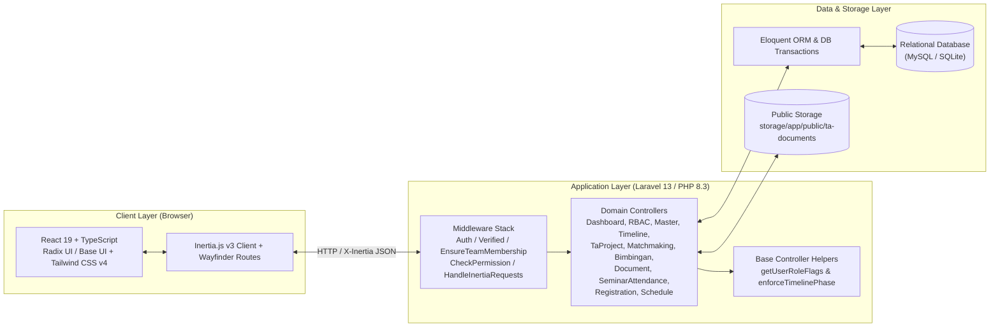
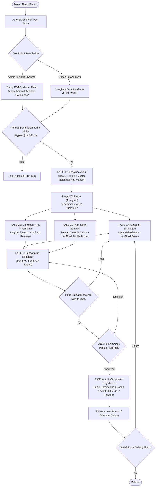
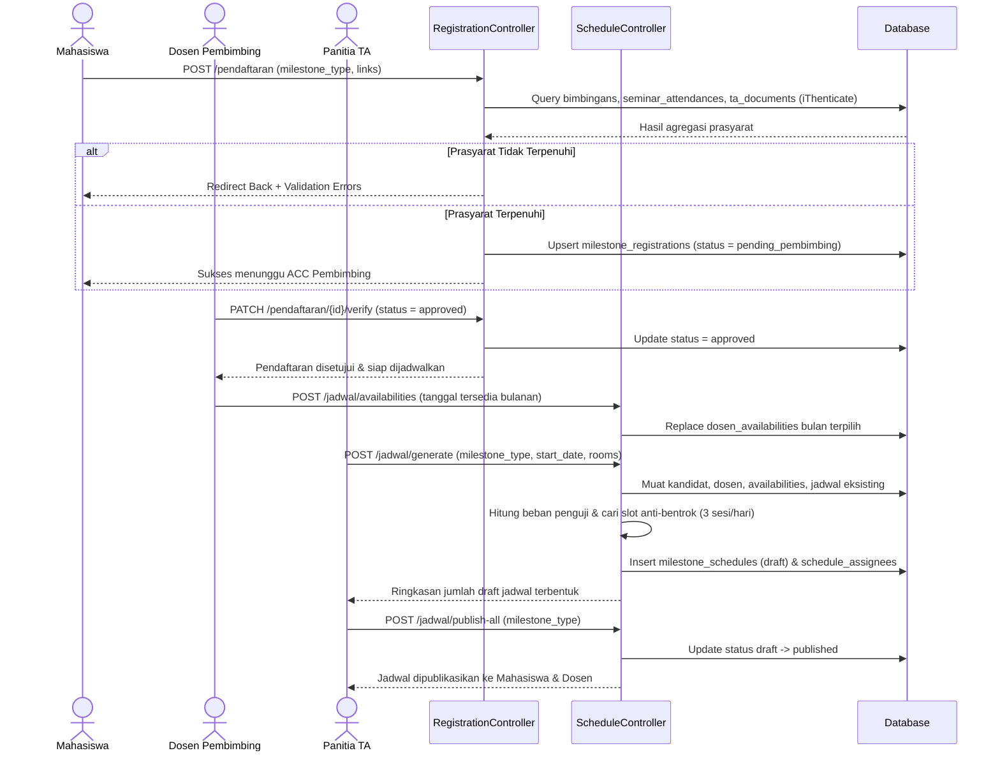

# RANCANGAN PERANGKAT LUNAK (RPP / SDD)
## Sistem Manajemen Tugas Akhir Terintegrasi

| Atribut Dokumen | Keterangan |
| :--- | :--- |
| **Nama Perangkat Lunak** | Sistem Manajemen Tugas Akhir Terintegrasi (`manajemen-ta`) |
| **Institusi Target** | Politeknik Manufaktur Bandung (TRMO, TRO, TRIN) |
| **Jenis Dokumen** | Software Design Description (SDD) / Rancangan Perangkat Lunak (RPP) |
| **Versi Dokumen** | 1.0 |
| **Tanggal Penyusunan** | 21 November 2026 |
| **Arsitektur Utama** | Monolith Modern berbasis Laravel 13 + Inertia.js v3 + React 19 (TypeScript) |

---

## Daftar Isi

1. [BAB 1 — Pendahuluan](#bab-1--pendahuluan)
2. [BAB 2 — Rancangan Arsitektur Perangkat Lunak](#bab-2--rancangan-arsitektur-perangkat-lunak)
3. [BAB 3 — Rancangan Alur Proses & Algoritma Inti](#bab-3--rancangan-alur-proses--algoritma-inti)
4. [BAB 4 — Rancangan Basis Data (ERD & Kamus Data)](#bab-4--rancangan-basis-data-erd--kamus-data)
5. [BAB 5 — Rancangan Modul & Pemetaan Endpoint](#bab-5--rancangan-modul--pemetaan-endpoint)
6. [BAB 6 — Rancangan Antarmuka Pengguna (UI/UX)](#bab-6--rancangan-antarmuka-pengguna-uiux)
7. [BAB 7 — Jaminan Kualitas & Matriks Keterlacakan](#bab-7--jaminan-kualitas--matriks-keterlacakan)

---

## BAB 1 — Pendahuluan

### 1.1 Tujuan Dokumen
Dokumen Rancangan Perangkat Lunak (RPP) ini bertujuan mendefinisikan secara komprehensif rancangan arsitektur, alur bisnis, algoritma pemrosesan, skema basis data, pemetaan modul, serta rancangan antarmuka pengguna untuk **Sistem Manajemen Tugas Akhir Terintegrasi**. Dokumen ini menjadi acuan teknis bagi pengembang, penguji, serta pemangku kepentingan akademik.

### 1.2 Ruang Lingkup Sistem
Sistem mengelola seluruh siklus hidup Tugas Akhir (TA) secara terintegrasi dalam satu platform web, meliputi:
- Pengelolaan otorisasi dinamis (*Role-Based Access Control* / RBAC) berbasis pemindaian route otomatis.
- Pengelolaan Data Master Akademik (Program Studi, Kompetensi, Jabatan Fungsional & Kuota), Tahun Ajaran, serta *Timeline Gatekeeper*.
- Pengelolaan Profil Akademik & *Skill Vector* untuk Dosen dan Mahasiswa.
- Bursa Judul, Pengajuan Judul (Tipe 1, Tipe 2, Mandiri), serta algoritma *Vector Matchmaking* otomatis.
- Pencatatan dan verifikasi Logbook Bimbingan (Pembimbing 1 & 2).
- Pengelolaan Arsip Dokumen TA dengan *versioning* dan pengecekan ambang skor plagiarisme iThenticate (≤ 25%).
- Pencatatan dan verifikasi Kehadiran Seminar (dual-mode penyaji dan audiens).
- Pendaftaran Milestone (`Sempro`, `Semhas`, `Sidang`) dengan validasi prasyarat otomatis di sisi server.
- Penjadwalan Ujian Otomatis (*Auto-Scheduler*) 3 sesi harian dengan pemerataan beban dosen dan proteksi anti-bentrok dosen/ruangan.

### 1.3 Karakteristik Pengguna & Matriks Peran (RBAC)

| Role | Tipe | Hak Akses & Tanggung Jawab Utama |
| :--- | :--- | :--- |
| **Admin** | System | Akses penuh ke seluruh fitur (`rbac.manage`, `master.manage`, `timeline.manage`, seluruh modul akademik) dan hak bypass gerbang periode timeline (*Admin Override*). |
| **Panitia** | System | Mengelola Master Data, Timeline, menjalankan & memfinalisasi *Vector Matchmaking*, memverifikasi dokumen/presensi/pendaftaran, men-generate & mempublikasikan jadwal ujian. |
| **Kaprodi** | System | Mengelola Master Data, menyetujui pengajuan judul Mandiri (`Pending Kaprodi` → `Assigned`), memverifikasi pendaftaran, serta berpartisipasi dalam pengelolaan jadwal sidang. |
| **Dosen Pembimbing** | System | Melengkapi *skill vector*, mengusulkan topik Tipe 1/Tipe 2, memverifikasi logbook bimbingan & dokumen bimbingan, menyetujui pendaftaran ujian mahasiswa bimbingan, mengisi ketersediaan tanggal sidang. |
| **Mahasiswa** | Default | Melengkapi *skill vector*, memilih 3 prioritas topik atau mengajukan judul Mandiri, mencatat logbook bimbingan, mengunggah dokumen & sertifikat iThenticate, mencatat audiens saat menjadi penyaji seminar, dan mendaftar Sempro/Semhas/Sidang. |

### 1.4 Ringkasan Kebutuhan Fungsional & Non-Fungsional

#### Kebutuhan Fungsional (Functional Requirements)
| Kode | Kebutuhan Fungsional | Modul Terkait |
| :--- | :--- | :--- |
| **FR-01** | Sistem menyediakan autentikasi aman (login, verifikasi email, 2FA, passkey) dan isolasi ruang kerja berbasis Team (`current_team`). | Auth, Fortify, Teams |
| **FR-02** | Admin dapat mengelola Role kustom dan *Permission Matrix* secara dinamis (termasuk *bulk toggle* per modul). | RBAC (`RbacController`) |
| **FR-03** | Panitia/Kaprodi dapat mengelola Master Data (Prodi, Kompetensi, Jabatan Fungsional), Tahun Ajaran aktif, dan fase Timeline. | Master Data & Timeline |
| **FR-04** | Dosen dan Mahasiswa dapat mengelola profil akademik beserta vektor kompetensi (`skill_vector`). | Profil Akademik |
| **FR-05** | Dosen dapat mengusulkan topik Tipe 1/Tipe 2; Mahasiswa dapat mengajukan judul Mandiri atau mengunci 3 prioritas topik Tipe 2. | Bursa & Pengajuan Judul |
| **FR-06** | Panitia dapat menjalankan algoritma *Vector Matchmaking*, melakukan *override* manual, melepas anggota draft, dan meresmikan tim (`Assigned`). | Matchmaking |
| **FR-07** | Mahasiswa mencatat logbook bimbingan; Dosen memverifikasi (`approved`/`rejected` + umpan balik). | Bimbingan |
| **FR-08** | Mahasiswa mengunggah 6 kategori dokumen TA (maks. 20 MB) dengan pelacakan versi; Dosen/Panitia memvalidasi berkas dan skor iThenticate. | Dokumen TA |
| **FR-09** | Penyaji seminar (`Sempro`/`Semhas`) mencatat daftar mahasiswa yang hadir; Panitia/Dosen memverifikasi presensi. | Kehadiran Seminar |
| **FR-10** | Mahasiswa mendaftar `Sempro`, `Semhas`, atau `Sidang` dengan validasi prasyarat otomatis di backend; Pembimbing/Panitia menyetujui atau menolak dengan catatan. | Pendaftaran Milestone |
| **FR-11** | Dosen menginput ketersediaan tanggal bulanan; Panitia men-generate draft jadwal otomatis anti-bentrok, melakukan penyesuaian manual, dan mempublikasikan jadwal. | Penjadwalan (`ScheduleController`) |

#### Kebutuhan Non-Fungsional (Non-Functional Requirements)
| Kode | Kategori | Spesifikasi |
| :--- | :--- | :--- |
| **NFR-01** | **Keamanan & Otorisasi** | Proteksi route dengan middleware `auth`, `verified`, `EnsureTeamMembership`, dan `permission:*`; validasi prasyarat akademik dijalankan di sisi server (*server-side enforcement*). |
| **NFR-02** | **Integritas Data** | Operasi kritikal (*Matchmaking*, *Auto-Scheduler*, simpan ketersediaan dosen) dibungkus dalam `DB::transaction` serta dilindungi *composite unique constraints*. |
| **NFR-03** | **Kegunaan (Usability)** | Antarmuka SPA responsif tanpa *full-page reload* (Inertia.js + React), mendukung mode terang/gelap (*appearance*), dan adaptif terhadap role pengguna. |
| **NFR-04** | **Keandalan Penjadwalan** | Algoritma penjadwalan menjamin tidak terjadi konflik slot waktu bagi dosen maupun ruangan pada 3 sesi harian standar. |
| **NFR-05** | **Pemeliharaan (Maintainability)** | Penulisan kode mengikuti standar PSR-12/Laravel Pint, tipe statis PHPStan/Larastan, dan TypeScript *strict checking* (`tsc --noEmit`). |

---

## BAB 2 — Rancangan Arsitektur Perangkat Lunak

### 2.1 Arsitektur Tingkat Tinggi
Aplikasi menerapkan pola **Modern Monolith (Server-Driven SPA)** menggunakan Laravel sebagai penyedia routing, otorisasi, logika bisnis, dan akses data, serta Inertia.js + React untuk merender antarmuka pengguna secara reaktif tanpa memerlukan API REST terpisah.

### 2.2 Tumpukan Teknologi (*Tech Stack*)

| Lapisan | Teknologi & Versi | Peran dalam Sistem |
| :--- | :--- | :--- |
| **Backend Framework** | PHP `^8.3`, Laravel `^13.17` | Routing, ORM, validasi, transaksi database, dan keamanan. |
| **Autentikasi** | Laravel Fortify `^1.37`, `@laravel/passkeys` | Login, registrasi, verifikasi email, reset password, 2FA, dan Passkey. |
| **Bridge SPA** | Inertia.js (`inertia-laravel ^3.0`, `@inertiajs/react ^3.0`), Wayfinder | Komunikasi controller-ke-komponen React secara *type-safe*. |
| **Frontend Framework** | React `^19.2`, TypeScript `^5.7`, Vite `^8.0` | Antarmuka reaktif berbasis komponen dengan React Compiler. |
| **UI & Styling** | Tailwind CSS `^4.0`, Radix UI, Base UI, Lucide React, Sonner | Sistem desain komponen aksesibel, ikonografi, dan notifikasi *toast*. |
| **Quality Assurance** | Pest `^5.1`, Larastan/PHPStan `^3.9`, Laravel Pint `^1.27` | Automated testing, analisis tipe statis, dan konsistensi format kode. |

### 2.3 Mekanisme Keamanan, Multi-Team, RBAC & Timeline Gatekeeper
1. **Isolasi Team (`{current_team}`)**: Seluruh route operasional berada di bawah prefix `{current_team}` yang dilindungi oleh middleware `EnsureTeamMembership` agar pengguna hanya mengakses ruang kerja yang menjadi keanggotaannya.
2. **Dynamic RBAC & Auto-Discovery (`RbacController`)**:
   - Permission disimpan sebagai array JSON pada tabel `roles` (misal: `master.manage`, `sidang.create`, `bimbingan.verify`).
   - `RbacController::discoverModulesAndPermissions()` memindai seluruh route terdaftar untuk mendeteksi modul dan aksi baru secara otomatis.
   - Role bertipe `System` dan `Default` diproteksi dari penghapusan.
3. **Timeline Gatekeeper (`Controller::enforceTimelinePhase`)**:
   - Mengunci aksi kritikal seperti pengajuan judul dan penguncian pilihan tema agar hanya berjalan dalam rentang tanggal `start_date`–`end_date` fase aktif pada `timeline_items`.
   - Pengguna dengan hak `Admin` mendapatkan *Admin Override* aman untuk keperluan administrasi darurat.

---

## BAB 3 — Rancangan Alur Proses & Algoritma Inti

### 3.1 Flowchart Utama End-to-End

### 3.2 Rancangan Algoritma Inti

#### A. Algoritma Vector Matchmaking (`MatchmakingController`)
Digunakan untuk memasangkan mahasiswa ke topik **Tipe 2** secara adil dan objektif:
1. **Prapemrosesan (Transactional Reset)**:
   - Hanya proyek `Tipe 2` berstatus `Matchmaking` atau `Draft Plotting` pada tahun ajaran aktif yang di-reset. Proyek berstatus `Assigned` (Tipe 1, Mandiri yang disetujui, atau hasil finalisasi sebelumnya) tidak tersentuh.
2. **Pengurutan Kandidat (FCFS)**:
   - Mengambil seluruh `tema_selections` berstatus `Locked`/`Matched` (di luar mahasiswa yang sudah `Assigned`), diurutkan secara *ascending* berdasarkan `locked_at`.
3. **Evaluasi Skor Kecocokan (`calculateMatchScore`)**:
   - Hanya mengevaluasi kompetensi pada `required_skills` dengan level syarat > 1.
   - Untuk setiap kompetensi syarat $i$ dengan target $T_i$ dan level aktual mahasiswa $A_i$:
     - Mahasiswa dinyatakan **`eligible = true`** apabila $A_i \ge T_i$ untuk seluruh kompetensi syarat.
     - Skor pemenuhan persentase dihitung sebagai:
       $$\text{score} = \text{round}\left(\frac{\sum \min(A_i, T_i)}{\sum T_i} \times 100\right)$$
4. **Penempatan & Finalisasi**:
   - Sistem mengevaluasi berurutan `pilihan_1_id` → `pilihan_2_id` → `pilihan_3_id`.
   - Pada pilihan pertama yang kuotanya masih tersedia (`mahasiswas()->count() < kuota`) dan `eligible == true`, mahasiswa dipasangkan ke proyek, status proyek menjadi `Draft Plotting`, dan status seleksi menjadi `Matched`.
   - Mahasiswa yang tidak cocok pada ketiga pilihan tetap berstatus `Locked` untuk di-*override* secara manual oleh Panitia (`overrideMatch`).
   - Panitia meresmikan seluruh `Draft Plotting` menjadi `Assigned` melalui aksi `finalizePlotting`.

#### B. Algoritma Validasi Prasyarat Pendaftaran Milestone (`RegistrationController::store`)
Validasi dijalankan secara ketat di server berdasarkan jenis milestone:
- **Sempro & Semhas**:
  - Jumlah logbook bimbingan `pembimbing_ke = 1` berstatus `approved` **minimal 6 sesi**.
  - Wajib melampirkan `dokumen_kti_link` dan `dokumen_produk_link`.
- **Sidang Akhir**:
  - Jumlah logbook bimbingan `pembimbing_ke = 1` berstatus `approved` **minimal 8 sesi**.
  - Jumlah kehadiran seminar (`seminar_attendances`) berstatus `approved` **minimal 5 kali**.
  - Dokumen kategori `ithenticate` telah diunggah dengan `similarity_score` **≤ 25%**.
  - Wajib melampirkan `bukti_pembayaran_link`.
- Pendaftaran yang lolos validasi disimpan dengan status `pending_pembimbing` untuk diverifikasi Pembimbing/Panitia (`approved` / `rejected`).

#### C. Engine Penjadwalan Otomatis Anti-Bentrok (`ScheduleController::generate`)
Menyusun jadwal `Sempro`, `Semhas`, dan `Sidang` pada 3 sesi standar harian (**Pagi** `08:30–10:00`, **Siang** `10:30–12:00`, **Sore** `13:30–15:00`) di 4 ruangan standar:
1. **Seleksi Kandidat Penguji**:
   - Mengecualikan Pembimbing 1 & Pembimbing 2 mahasiswa terkait (`excludedIds`).
   - Mengurutkan kandidat penguji secara *ascending* berdasarkan skor biaya penugasan:
     $$\text{Cost}(d) = P_{\text{prodi}}(d) + (10 \times \text{Load}(d)) - \text{Weight}(d)$$
     dengan $P_{\text{prodi}} = 0$ jika satu prodi dengan mahasiswa dan $100$ jika berbeda prodi, $\text{Load}(d)$ adalah jumlah jadwal yang telah diemban dosen, dan $\text{Weight}(d)$ adalah bobot jabatan fungsional.
2. **Komposisi Tim Penguji**:
   - **Sidang**: `penguji_utama`, `penguji_pendamping_1`, `penguji_pendamping_2`, `pembimbing_utama`.
   - **Sempro / Semhas**: `penguji_utama`, `penguji_pendamping`, `pembimbing_utama`, `pembimbing_pendamping`.
3. **Pencarian Slot Optimal Anti-Bentrok**:
   - Tanggal kandidat (dari `dosen_availabilities`, atau *fallback* 14 hari kerja ke depan) diurutkan berdasarkan jumlah anggota tim yang tersedia pada tanggal tersebut.
   - Untuk setiap kombinasi `(tanggal, sesi, ruangan)`, sistem memastikan tidak ada satupun dosen tim pada `busyDosenSlots` dan ruangan tidak berada pada `busyRoomSlots`.
   - Jika seluruh slot penuh, sistem menerapkan *fallback* ke hari kerja berikutnya pada Sesi Pagi.
   - Jadwal disimpan sebagai `draft`, dapat diedit/di-*override* Panitia (dengan peringatan jika melanggar kalender ketersediaan dosen), lalu diresmikan menjadi `published`.

### 3.3 Sequence Diagram — Pendaftaran hingga Publikasi Jadwal Sidang

---

## BAB 4 — Rancangan Basis Data (ERD & Kamus Data)

### 4.1 Entity Relationship Diagram (ERD)

```mermaid
erDiagram
    teams ||--o{ users : "current_team_id"
    teams ||--o{ team_members : "memiliki"
    users ||--o{ team_members : "tergabung"
    teams ||--o{ team_invitations : "mengundang"
    users ||--o{ team_invitations : "invited_by"

    users ||--o{ role_user : "memiliki"
    roles ||--o{ role_user : "diberikan ke"

    users ||--o| dosen_profiles : "profil dosen"
    users ||--o| mahasiswa_profiles : "profil mahasiswa"
    prodis ||--o{ dosen_profiles : "prodi"
    prodis ||--o{ mahasiswa_profiles : "prodi"
    jabatan_fungsionals ||--o{ dosen_profiles : "jabatan"
    academic_years ||--o{ mahasiswa_profiles : "tahun ajaran"

    academic_years ||--o{ timelines : "memiliki"
    timelines ||--o{ timeline_items : "berisi fase"

    academic_years ||--o{ ta_projects : "periode"
    users ||--o{ ta_projects : "pengusul_id"
    ta_projects ||--o{ project_mahasiswas : "anggota tim"
    users ||--o{ project_mahasiswas : "mahasiswa_id"
    ta_projects ||--o{ project_pembimbings : "pembimbing"
    users ||--o{ project_pembimbings : "dosen_id"

    academic_years ||--o{ tema_selections : "periode"
    users ||--o{ tema_selections : "mahasiswa_id"
    ta_projects ||--o{ tema_selections : "pilihan 1/2/3"

    teams ||--o{ bimbingans : "team_id"
    ta_projects ||--o{ bimbingans : "ta_project_id"
    users ||--o{ bimbingans : "user_id & lecturer_id"

    teams ||--o{ ta_documents : "team_id"
    users ||--o{ ta_documents : "user_id & reviewed_by"

    users ||--o{ milestone_registrations : "mahasiswa_id"
    users ||--o{ milestone_schedules : "mahasiswa_id"
    academic_years ||--o{ milestone_schedules : "academic_year_id"
    milestone_schedules ||--o{ schedule_assignees : "tim penguji/pembimbing"
    users ||--o{ schedule_assignees : "dosen"

    teams ||--o{ seminar_attendances : "team_id"
    milestone_schedules ||--o{ seminar_attendances : "sesi seminar"
    users ||--o{ seminar_attendances : "peserta & verifikator"

    users ||--o{ dosen_availabilities : "slot tersedia"
    users ||--o{ dosen_blocks : "slot blokir"

    competencies ||..o{ dosen_profiles : "skill_vector JSON"
    competencies ||..o{ mahasiswa_profiles : "skill_vector JSON"
    competencies ||..o{ ta_projects : "required_skills JSON"
```

### 4.2 Kamus Data Ringkas (22 Entitas Bisnis)

| No | Nama Tabel | Primary & Foreign Keys | Kolom & Constraint Penting | Deskripsi |
| :---: | :--- | :--- | :--- | :--- |
| 1 | `users` | PK `id`, FK `current_team_id` | `email` (UK), `password`, `email_verified_at` | Akun pengguna seluruh aktor sistem. |
| 2 | `teams` | PK `id` | `name`, `slug` (UK), `is_personal`, `deleted_at` | Ruang kerja (*tenant/team*) pengguna. |
| 3 | `team_members` | PK `id`, FK `team_id`, `user_id` | `role`, UK `(team_id, user_id)` | Keanggotaan pengguna dalam team. |
| 4 | `team_invitations` | PK `id`, FK `team_id`, `invited_by` | `code` (UK), `email`, `expires_at`, `accepted_at` | Undangan bergabung ke team. |
| 5 | `roles` | PK `id` | `name` (UK), `type`, `permissions` (JSON) | Definisi role & matriks izin granular. |
| 6 | `role_user` | PK `id`, FK `user_id`, `role_id` | UK `(user_id, role_id)` | Pivot relasi many-to-many user dan role. |
| 7 | `prodis` | PK `id` | `name`, `code` (UK) | Data master Program Studi (TRMO, TRO, TRIN). |
| 8 | `competencies` | PK `id` | `name`, `code` (UK) | Data master bidang keahlian pembentuk *skill vector*. |
| 9 | `jabatan_fungsionals` | PK `id` | `name`, `weight_score`, `max_kuota_bimbingan` | Master jabatan fungsional & bobot kuota dosen. |
| 10 | `dosen_profiles` | PK `id`, FK `user_id`, `prodi_id`, `jabatan_fungsional_id` | `nip`, `weight_score`, `skill_vector` (JSON) | Profil akademik & kompetensi dosen. |
| 11 | `mahasiswa_profiles` | PK `id`, FK `user_id`, `prodi_id`, `academic_year_id` | `nim`, `angkatan`, `skill_vector` (JSON), `academic_status` (ENUM) | Profil akademik, status progres & skill mahasiswa. |
| 12 | `academic_years` | PK `id` | `name`, `semester` (`Ganjil`/`Genap`), `is_active` | Master periode tahun ajaran aktif. |
| 13 | `timelines` | PK `id`, FK `academic_year_id` | `name`, `is_locked` | Blueprint timeline induk per tahun ajaran. |
| 14 | `timeline_items` | PK `id`, FK `timeline_id` | `name`, `system_code`, `start_date`, `end_date`, `order_index` | Item fase waktu untuk *Timeline Gatekeeper*. |
| 15 | `ta_projects` | PK `id`, FK `academic_year_id`, `pengusul_id` | `tipe` (`Tipe 1`/`Tipe 2`/`Mandiri`), `judul`, `required_skills` (JSON), `kuota`, `status` (ENUM) | Entitas utama judul/proyek Tugas Akhir. |
| 16 | `project_mahasiswas` | PK `id`, FK `ta_project_id`, `mahasiswa_id` | UK `(ta_project_id, mahasiswa_id)` | Pivot anggota mahasiswa dalam satu proyek TA. |
| 17 | `project_pembimbings` | PK `id`, FK `ta_project_id`, `dosen_id` | `role` (`Utama`/`Pendamping`), `urutan`, UK `(ta_project_id, dosen_id)` | Pivot dosen pembimbing 1 & 2 pada proyek TA. |
| 18 | `tema_selections` | PK `id`, FK `academic_year_id`, `mahasiswa_id`, `pilihan_1_id`, `pilihan_2_id`, `pilihan_3_id` | `locked_at`, `status` (`Draft`/`Locked`/`Matched`/`Overridden`), UK `(academic_year_id, mahasiswa_id)` | Pilihan prioritas topik Tipe 2 oleh mahasiswa. |
| 19 | `bimbingans` | PK `id`, FK `team_id`, `ta_project_id`, `user_id`, `lecturer_id` | `pembimbing_ke` (1/2), `date`, `topic`, `notes`, `next_action`, `status`, `lecturer_feedback`, `verified_at` | Logbook bimbingan mingguan & status verifikasi dosen. |
| 20 | `ta_documents` | PK `id`, FK `team_id`, `user_id`, `reviewed_by` | `category`, `title`, `file_path`, `file_name`, `file_size`, `similarity_score` (decimal 5,2), `version`, `status` | Arsip berkas TA, versi unggahan, dan skor iThenticate. |
| 21 | `milestone_registrations` | PK `id`, FK `mahasiswa_id` | `milestone_type`, `dokumen_kti_link`, `dokumen_produk_link`, `bukti_pembayaran_link`, `jumlah_kehadiran_seminar`, `status`, UK `(mahasiswa_id, milestone_type)` | Pengajuan pendaftaran Sempro, Semhas, & Sidang. |
| 22 | `milestone_schedules` & `schedule_assignees` | PK `id`, FK `mahasiswa_id`, `academic_year_id`; Pivot FK `milestone_schedule_id`, `user_id` | `milestone_type`, `date`, `time_start`, `time_end`, `room`, `status` (`draft`/`published`/`completed`); `role_type`, UK `(milestone_schedule_id, user_id)` | Jadwal ujian & susunan tim penguji/pembimbing. |
| 23 | `seminar_attendances` | PK `id`, FK `team_id`, `user_id`, `milestone_schedule_id`, `verified_by` | `seminar_title`, `presenter_name`, `milestone_type`, `date`, `location`, `summary`, `status` | Catatan kehadiran audiens seminar & verifikasi. |
| 24 | `dosen_availabilities` & `dosen_blocks` | PK `id`, FK `user_id` | `date`, `time_start`, `time_end`, `keterangan` / `reason` | Kalender ketersediaan & pemblokiran jadwal dosen. |

### 4.3 Strategi Penyimpanan Berkas (*File Storage*)
- Berkas dokumen TA disimpan pada disk `public` dengan pola direktori `ta-documents/{user_id}/`.
- Ukuran berkas dibatasi maksimal **20 MB** (`max:20480` KB) untuk 6 kategori: `proposal`, `laporan_semhas`, `laporan_akhir`, `ithenticate`, `orisinalitas`, dan `produk`.
- Unggahan ulang pada kategori yang belum `approved` akan menghapus file lama secara otomatis, menaikkan kolom `version` (`version + 1`), dan mereset status ke `pending`.

---

## BAB 5 — Rancangan Modul & Pemetaan Endpoint

### 5.1 Pemetaan Modul Backend (`routes/web.php` & `routes/settings.php`)

| Modul | Controller | Middleware / Izin | Endpoint Utama |
| :--- | :--- | :--- | :--- |
| **Dashboard** | `DashboardController` | `auth`, `verified`, `EnsureTeamMembership` | `GET /{team}/dashboard` |
| **RBAC** | `RbacController` | `permission:rbac.manage` | `GET /{team}/rbac`, `POST /rbac/roles`, `POST /rbac/users/{user}/roles/{role}`, `POST /rbac/roles/{role}/permissions`, `POST /rbac/roles/{role}/permissions/bulk` |
| **Master Data** | `MasterDataController` | `permission:master.manage` | `GET /{team}/master-data`, `POST/DELETE` untuk `prodi`, `competency`, `jabatan` |
| **Tahun Ajaran & Timeline** | `AcademicYearController`, `TimelineController` | `permission:master.manage` | `POST /academic-years`, `POST /set-active`, `GET /timeline-kontrol`, `POST /generate-timeline`, CRUD & reorder `timeline-items` |
| **Profil Akademik** | `AcademicProfileController` | `auth`, `verified` | `GET /settings/profil-akademik`, `POST /dosen`, `POST /mahasiswa` |
| **Bursa & Judul TA** | `TaProjectController` | `auth`, `verified` (+ `master.manage` utk approve) | `GET /{team}/tema-matchmaking`, `POST /ta-projects`, `POST /ta-projects/{project}/approve` |
| **Matchmaking** | `MatchmakingController` | `permission:master.manage` (kecuali `lock`) | `POST /tema-matchmaking/lock`, `POST /run-algorithm`, `POST /{project}/override`, `DELETE /{project}/members/{mhs}`, `POST /finalize` |
| **Bimbingan** | `BimbinganController` | `auth`, `verified` (+ cek kepemilikan & dosen) | `GET/POST /{team}/bimbingan`, `PUT/DELETE /bimbingan/{id}`, `PATCH /bimbingan/{id}/verify` |
| **Dokumen TA** | `DocumentController` | `auth`, `verified` (+ cek reviewer) | `GET/POST /{team}/dokumen`, `POST /dokumen/{id}/replace`, `DELETE /dokumen/{id}`, `PATCH /dokumen/{id}/verify` |
| **Kehadiran Seminar** | `SeminarAttendanceController` | `auth`, `verified` (+ cek penyaji / verifier) | `GET /{team}/kehadiran-seminar`, `POST /record-attendees`, `PUT/DELETE /{id}`, `PATCH /{id}/verify` |
| **Pendaftaran Milestone** | `RegistrationController` | `auth`, `verified` (+ cek approver) | `GET/POST /{team}/pendaftaran`, `PATCH /pendaftaran/{id}/verify` |
| **Penjadwalan** | `ScheduleController` | `auth`, `verified` (+ `permission:sidang.create` utk Panitia) | `GET /{team}/jadwal`, `POST/DELETE /jadwal/availabilities`, `POST /jadwal/generate`, `POST /jadwal/{id}/assignee`, `PUT /jadwal/{id}`, `POST /publish`, `POST /publish-all` |

### 5.2 Pemetaan Halaman Frontend (`resources/js/pages/`)

| Halaman (`.tsx`) | Aktor Pengguna | Fungsi Utama UI |
| :--- | :--- | :--- |
| `dashboard.tsx` | Semua Role | Dashboard adaptif 3 mode: ringkasan metrik institusi (Admin/Panitia), antrean bimbingan & jadwal menguji (Dosen), dan pelacak progres 4 milestone (Mahasiswa). |
| `rbac.tsx` | Admin | Manajemen daftar role, penugasan role ke user, dan matriks sakelar permission per modul. |
| `master-data.tsx` | Admin, Panitia, Kaprodi | CRUD Prodi, Kompetensi (*skill vector*), dan Jabatan Fungsional beserta bobot/kuota. |
| `timeline.tsx` | Admin, Panitia | Pemilihan Tahun Ajaran aktif, generator blueprint timeline, pengaturan rentang tanggal fase, dan pengurutan (*reorder*). |
| `academic-profile.tsx` | Dosen, Mahasiswa | Form profil NIP/NIM, Prodi, Jabatan/Angkatan, dan slider/input level kompetensi (`skill_vector`). |
| `tema-matchmaking.tsx` | Semua Role | Pengajuan topik (Tipe 1/2/Mandiri), bursa topik dengan skor kecocokan, penguncian 3 prioritas, eksekusi algoritma, override manual, dan finalisasi plotting. |
| `bimbingan.tsx` | Mahasiswa, Dosen | Pencatatan logbook bimbingan, indikator progres menuju target 8 sesi per pembimbing, dan antrean verifikasi dosen. |
| `dokumen.tsx` | Mahasiswa, Dosen, Panitia | Checklist 6 dokumen wajib, pengunggahan berkas + input skor iThenticate, pelacakan versi, dan panel review dokumen. |
| `kehadiran-seminar.tsx` | Mahasiswa, Dosen, Panitia | Tampilan peserta (*read-only* target 5 kehadiran), panel penyaji untuk mencatat daftar hadir peserta seminar miliknya, dan panel verifikasi Panitia/Dosen. |
| `pendaftaran.tsx` | Mahasiswa, Dosen, Panitia | Evaluasi prasyarat otomatis (bimbingan, seminar, iThenticate, dokumen), form pengajuan Sempro/Semhas/Sidang, dan antrean ACC approver. |
| `jadwal.tsx` | Semua Role | Kalender ketersediaan tanggal bulanan Dosen, tombol *Auto-Generate* Panitia, editor waktu/ruangan/penguji dengan peringatan konflik, tombol publikasi, dan tabel jadwal resmi. |
| `settings/*` & `teams/*` | Semua Role | Pengaturan profil akun, keamanan (password, 2FA, passkeys), tema tampilan, dan manajemen anggota/undangan team. |

---

## BAB 6 — Rancangan Antarmuka Pengguna (UI/UX)

### 6.1 Prinsip Tata Letak & Navigasi
- **App Shell Responsif**: Menggunakan tata letak *sidebar* kiri yang dapat diciutkan (*collapsible*) dengan *header breadcrumb* dan pemilih Team (*Team Switcher*).
- **Navigasi Adaptif Berbasis Permission**: Menu navigasi menampilkan modul sesuai peran dan izin aktif pengguna untuk mengurangi beban kognitif.
- **Umpan Balik Real-Time**: Setiap aksi mutasi data (simpan, verifikasi, tolak, publikasi) menampilkan notifikasi *toast* (`sonner`) dan validasi inline per kolom input.
- **Dukungan Mode Tampilan**: Mendukung mode terang (*light*), gelap (*dark*), dan sinkronisasi sistem melalui middleware `HandleAppearance`.

### 6.2 Struktur Layar Operasional Utama
1. **Dashboard Multi-Perspektif**:
   - *Admin/Panitia*: Kartu KPI (Total Mahasiswa, Proyek Aktif, Jadwal Draft/Published, Presensi Pending), tabel jadwal mendatang, dan daftar proyek terbaru.
   - *Dosen*: Kartu KPI (Proyek Bimbingan, Bimbingan Pending, Jadwal Menguji Mendatang) beserta daftar singkat bimbingan terbaru.
   - *Mahasiswa*: Kartu info Judul & Pembimbing, progres bar Bimbingan (`x/8`) & Seminar (`x/5`), status iThenticate, jadwal ujian terdekat, dan *stepper* 4 tahapan milestone TA.
2. **Halaman Bursa Tema & Matchmaking**:
   - Terdiri dari tab Bursa Topik, Form Pengajuan Judul, Panel Kunci 3 Prioritas (Mahasiswa), serta Tab Hasil *Draft Plotting* & Daftar Mahasiswa *Unmatched* (Panitia).
3. **Halaman Penjadwalan Enterprise**:
   - Memisahkan tab Kalender Ketersediaan Dosen, Panel Generator Otomatis (pilih milestone, tanggal mulai, daftar ruangan), dan Tabel Jadwal dengan modal ubah penguji/waktu/ruangan serta tombol *Publish* satuan maupun massal.

---

## BAB 7 — Jaminan Kualitas & Matriks Keterlacakan

### 7.1 Pipeline Verifikasi Otomatis
Kualitas perangkat lunak dijaga melalui skrip terintegrasi (`composer run ci:check` dan `composer run test`):
1. **Code Style**: Laravel Pint (`pint --parallel --test`) dan formatter frontend (`npm run check`).
2. **Static Analysis**: PHPStan/Larastan (`phpstan analyse`) dan TypeScript compiler (`tsc --noEmit`).
3. **Automated Testing**: Pest PHP (`php artisan test`) untuk pengujian fitur autentikasi, otorisasi, dan logika bisnis.

### 7.2 Matriks Keterlacakan (*Requirement Traceability Matrix*)

| ID Kebutuhan | Controller / Komponen Backend | Tabel Database Utama | Halaman Frontend |
| :--- | :--- | :--- | :--- |
| **FR-01** | Fortify, `TeamController`, `EnsureTeamMembership` | `users`, `teams`, `team_members`, `team_invitations` | `auth/*`, `teams/*`, `settings/security.tsx` |
| **FR-02** | `RbacController`, `CheckPermission` | `roles`, `role_user` | `rbac.tsx` |
| **FR-03** | `MasterDataController`, `AcademicYearController`, `TimelineController` | `prodis`, `competencies`, `jabatan_fungsionals`, `academic_years`, `timelines`, `timeline_items` | `master-data.tsx`, `timeline.tsx` |
| **FR-04** | `AcademicProfileController` | `dosen_profiles`, `mahasiswa_profiles` | `academic-profile.tsx` |
| **FR-05 & FR-06** | `TaProjectController`, `MatchmakingController` | `ta_projects`, `project_mahasiswas`, `project_pembimbings`, `tema_selections` | `tema-matchmaking.tsx` |
| **FR-07** | `BimbinganController` | `bimbingans` | `bimbingan.tsx` |
| **FR-08** | `DocumentController` | `ta_documents` | `dokumen.tsx` |
| **FR-09** | `SeminarAttendanceController` | `seminar_attendances` | `kehadiran-seminar.tsx` |
| **FR-10** | `RegistrationController` | `milestone_registrations` | `pendaftaran.tsx` |
| **FR-11** | `ScheduleController` | `milestone_schedules`, `schedule_assignees`, `dosen_availabilities`, `dosen_blocks` | `jadwal.tsx` |
